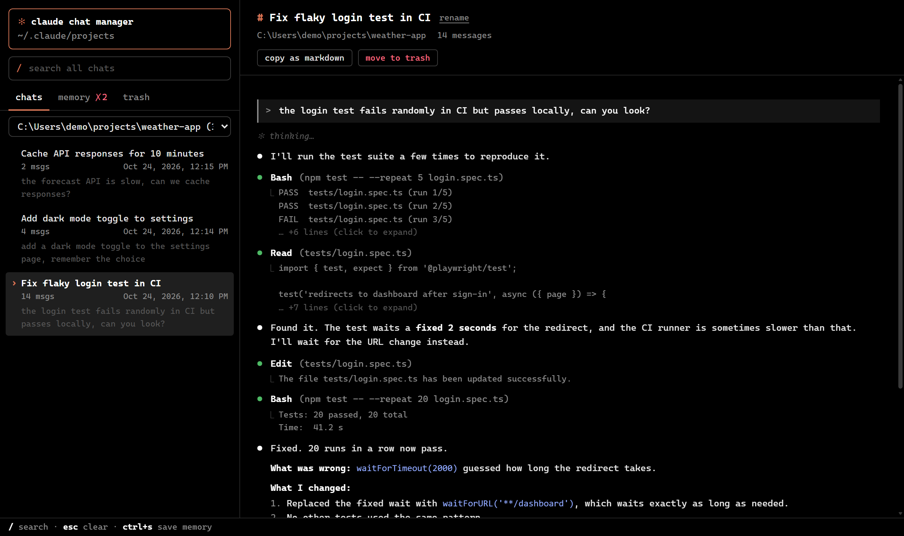
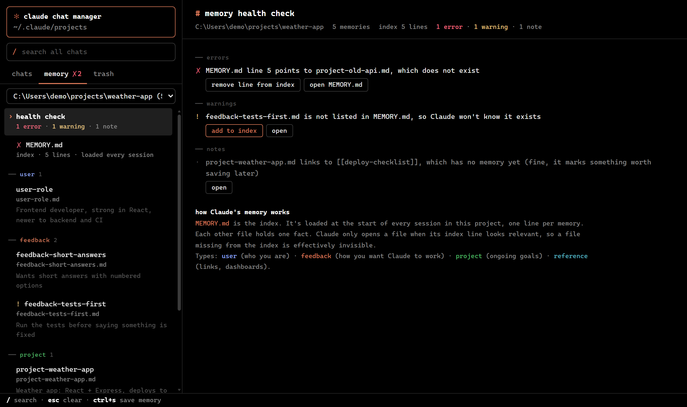
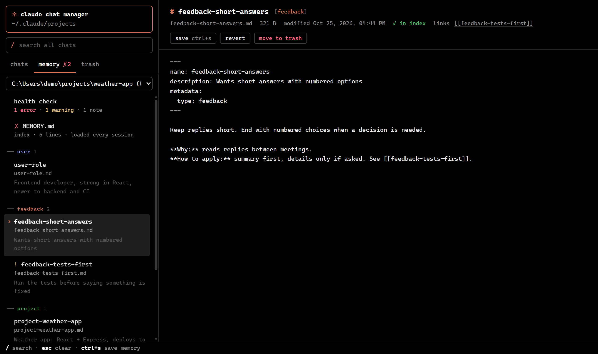
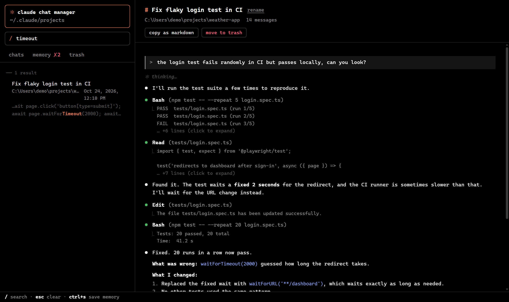

# Claude Chat Manager

A local web UI for browsing, searching and cleaning up your [Claude Code](https://claude.com/claude-code) chats, and for seeing and fixing what Claude remembers between sessions.

It reads the files Claude Code already keeps in `~/.claude/projects`. Nothing leaves your machine, and there are no dependencies beyond Node.js.



## Features

**Chats**
- Browse every Claude Code session, grouped by project.
- Transcripts look like the terminal: `>` for your prompts, `●` for Claude's replies and tool calls, `⎿` for tool output (click to expand). Thinking and system reminders are folded away.
- Search across all chats, rename them, copy one as Markdown, or move it to trash (restore any time).

**Memory**
- See and edit Claude's memory files and the `MEMORY.md` index for each project.
- A health check finds index lines pointing to deleted files, memories missing from the index (so Claude never sees them), incomplete frontmatter, near-duplicate memories, and an index longer than the 200 lines Claude loads. Most problems have a one-click fix.
- Create new memories from a template; they're added to the index automatically.
- Saves never overwrite a change Claude made while you were editing.







## Run it

Needs [Node.js](https://nodejs.org) 18 or newer.

```sh
node server.js
```

Then open http://localhost:5173. On Windows you can double-click `run.bat` instead, which starts the server and opens the browser.

Use a different port with `PORT=8080 node server.js`.

## Keyboard

| Key | Action |
| --- | --- |
| `/` | Search all chats |
| `Esc` | Clear search |
| `Ctrl+S` | Save the open memory file |

## How it stores things

- Renamed titles are kept in `data/overrides.json`; your chat files are never rewritten.
- Trashed chats and memories are moved to `data/trash` and `data/memory-trash`. "Delete forever" removes them for good.
- Memory files can only be changed from the same computer, because Claude reads them as instructions.

Screenshots use made-up demo data.
